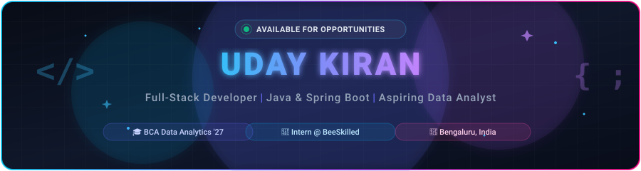
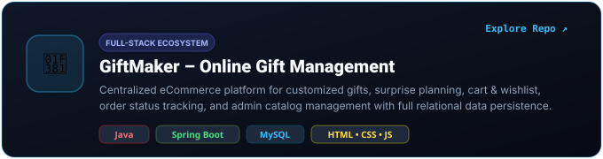
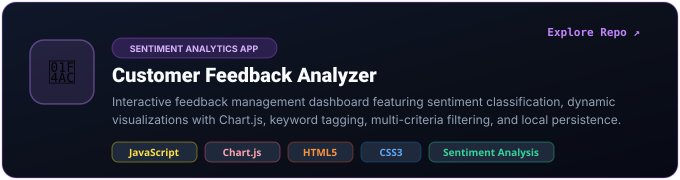
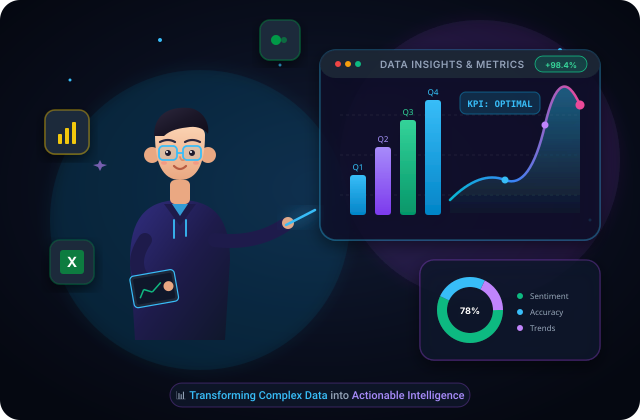
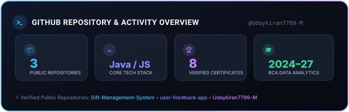
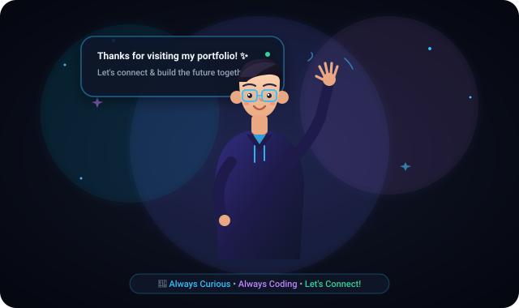

  <!-- ==================== HERO BANNER ==================== -->
  

    

  <!-- ==================== TYPING TEXT ANIMATION ==================== -->
  

   

  <!-- Quick Action Badges -->
  

    
    
    
  

  

<!-- ==================== CARTOON INTRO & ABOUT ME ==================== -->
## 👨‍💻 About Me

<table>
  <tr>
    <td width="48%" align="center" valign="middle">
      
    </td>
    <td width="52%" valign="top">
      <h3>Hey there, I'm Uday Kiran! 👋</h3>
      

        I am a driven <strong>Full-Stack Developer</strong> and aspiring <strong>Data Analyst</strong> currently pursuing my <strong>BCA in Data Analytics</strong> at <strong>Kristu Jayanti College, Bengaluru</strong> (2024–2027).
      

      

        My engineering journey revolves around building high-performance, scalable web systems using <strong>Java &amp; Spring Boot</strong>, paired with intuitive frontends and robust relational database architectures. Simultaneously, my data analytics background fuels my passion for turning raw numbers into <strong>actionable business insights</strong> and automated decision intelligence.
      

      <ul>
        <li>🎓 <strong>Education:</strong> BCA in Data Analytics @ Kristu Jayanti College (2024–2027)</li>
        <li>💼 <strong>Internship:</strong> Data Analyst Intern @ <strong>BeeSkilled</strong></li>
        <li>📍 <strong>Location:</strong> Bengaluru, Karnataka, India</li>
        <li>⚡ <strong>Focus Areas:</strong> Spring Boot REST APIs, Relational Schema Design, Data Analytics Pipelines &amp; Interactive Dashboards</li>
      </ul>
    </td>
  </tr>
</table>

  

<!-- ==================== TECHNICAL SKILLS ==================== -->
## 🛠️ Technical Stack &amp; Tooling

  ### 💻 Programming Languages
  

    
    
    
    
  

  ### 🌐 Web &amp; Backend Frameworks
  

    
    
    
    
    
  

  ### 🗄️ Databases &amp; Storage
  

    
    
  

  ### 📊 Data Analytics &amp; Business Intelligence
  

    
    
    
    
  

  ### 🧰 Developer Tools &amp; Environment
  

    
    
    
    
  

  

<!-- ==================== FEATURED PROJECTS ==================== -->
## 🚀 Featured Projects

  

 

### 1️⃣ GiftMaker – Online Gift Management System

* **Repository:** [Udaykiran7799-M/Gift-Management-System](https://github.com/Udaykiran7799-M/Gift-Management-System)
* **Architecture:** Full-stack Enterprise Web Application
* **Technologies:** Java, Spring Boot, MySQL, HTML5, CSS3, JavaScript, Maven
* **Key Capabilities:**
  * 🎁 **Catalog & Occasion Exploration:** Dynamic gift catalog categorized by occasions, holidays, and recipients.
  * 🎨 **Bespoke Custom Requests:** Special modules allowing users to request tailored custom gifts, customized magazines, and surprise planning.
  * 🛒 **Cart & Wishlist Engine:** Robust shopping cart state management, persistent user wishlist, and flexible delivery address book.
  * 📦 **Order Processing:** End-to-end checkout workflow with active order tracking and chronological order history.
  * 🛡️ **Comprehensive Admin Dashboard:** Complete administrative CRUD for products, order moderation, custom request reviews, and discount offers.
  * 🗄️ **Relational Database Design:** 11 normalized MySQL tables (`Users`, `Products`, `Orders`, `Order_Items`, `Cart_Items`, `Wishlist_Items`, `User_Addresses`, `Offers`, `Custom_Gift_Requests`, `Custom_Magazine_Requests`, `Surprise_Requests`).

 

### 2️⃣ Customer Feedback Analyzer (User Feedback App)

* **Repository:** [Udaykiran7799-M/user-feedback-app](https://github.com/Udaykiran7799-M/user-feedback-app)
* **Architecture:** Client-Side Analytics &amp; Sentiment Analysis Dashboard
* **Technologies:** Vanilla JavaScript (ES6+), Chart.js, HTML5, CSS3, FontAwesome
* **Key Capabilities:**
  * 🧠 **Real-Time Sentiment Classification:** Automatically parses customer feedback and tags it into Positive, Neutral, or Negative sentiment categories.
  * 📊 **Interactive Data Visualizations:** High-fidelity Chart.js Doughnut chart for sentiment ratio distribution and Category distribution breakdown.
  * 🏷️ **Dynamic Tag Cloud:** Automatic keyword extraction and cloud tagging for rapid trend recognition.
  * 🔍 **Multi-Dimensional Filters:** Instant filtering by feedback category (Product, Service, Support, Website), sentiment status, and star rating (1–5 stars).
  * 💾 **State Persistence:** Instant browser `localStorage` caching ensuring zero data loss without requiring external backend servers.

  

<!-- ==================== INTERNSHIP EXPERIENCE ==================== -->
## 💼 Professional Experience

<table>
  <tr>
    <td width="50%" valign="top">
      <h3>Data Analyst Intern</h3>
      
<strong>BeeSkilled</strong> • <em>Bengaluru, India</em>

      

        Engaged in hands-on data analytics operations, exploratory data analysis (EDA), and business intelligence dashboard design.
      

      <ul>
        <li>📊 <strong>Data Cleaning &amp; Transformation:</strong> Cleaned, normalized, and preprocessed structured multi-source datasets to ensure statistical accuracy.</li>
        <li>📈 <strong>Exploratory Data Analysis:</strong> Conducted statistical modeling, trend analysis, and variance detection to extract business insights.</li>
        <li>🎨 <strong>Visual Dashboards:</strong> Designed intuitive reporting dashboards using Power BI and Excel for executive stakeholder presentations.</li>
        <li>⚙️ <strong>Process Optimization:</strong> Automated routine data aggregation workflows, accelerating reporting velocity.</li>
      </ul>
    </td>
    <td width="50%" align="center" valign="middle">
      
    </td>
  </tr>
</table>

  

<!-- ==================== CERTIFICATIONS SHOWCASE ==================== -->
## 🏆 Verified Certifications

Professional credentials and certifications backed by official PDF credentials stored directly within this repository:

| # | Certification Title | Issuing Organization | Credential / Verification |
|:---:|:---|:---|:---:|
| 1 | **Google Analytics Certification** | Google (Skillshop) | [📄 View Certificate PDF](certificates/Google_Analytics.pdf) |
| 2 | **Programming in Java (Elite)** | NPTEL (IIT Kharagpur) | [📄 View Certificate PDF](certificates/NPTEL_java.pdf) |
| 3 | **Digital Engineering Gold** | NASSCOM FutureSkills Prime | [📄 View Certificate PDF](certificates/Nasscom.pdf) |
| 4 | **Data Analytics Certification** | Qlik | [📄 View Certificate PDF](certificates/Qlik_Data_Analytics.pdf) |
| 5 | **Data Literacy Certification** | Qlik | [📄 View Certificate PDF](certificates/Qlik_Data_Literacy.pdf) |
| 6 | **AI and Cloud Learning** | IBM SkillsBuild | [📄 View Certificate PDF](certificates/IBM.pdf) |
| 7 | **Database and AI Learning** | MongoDB University | [📄 View Certificate PDF](certificates/MongoDB.pdf) |
| 8 | **Automation Developer Training** | UiPath | [📄 View Certificate PDF](certificates/UIpath.pdf) |

 

  

  

<!-- ==================== GITHUB STATISTICS DASHBOARD ==================== -->
## 📈 GitHub Statistics &amp; Activity

  <!-- Guaranteed High-Uptime Custom GitHub Overview Card -->
  

    

  <!-- GitHub Streak Stats (Demolab API - 100% Verified) -->
  

 

<!-- ==================== CONTRIBUTION GRAPH ==================== -->
## 📊 Contribution Activity

  
  

    <em>Real-time commit and contribution history on GitHub</em>
  

  

<!-- ==================== CURRENTLY LEARNING ==================== -->
## 🧠 Currently Expanding &amp; Exploring

* 🧩 **Advanced Data Structures &amp; Algorithms:** Honing algorithmic efficiency in Java (Dynamic Programming, Graph Theory, Trees).
* 🤖 **Applied Machine Learning:** Building end-to-end data pipelines for predictive analytics using Python.
* ☁️ **Cloud Native Architectures:** Containerizing Spring Boot microservices with Docker and orchestrating scalable deployments.

  

<!-- ==================== CONTACT & SOCIALS ==================== -->
## 📬 Connect With Me

I am always keen to discuss software engineering opportunities, data analytics internships, and open-source collaborations.

  

    
    
    
  

  

    📍 <strong>Bengaluru, Karnataka, India</strong> &nbsp;•&nbsp; 🎓 <strong>Kristu Jayanti College (BCA '27)</strong>
  

  

  <!-- ==================== ANIMATED CLOSING FOOTER ==================== -->
   
  

    

  

    <em>"The goal is to turn data into information, and information into insight."</em> 
    <strong>Designed &amp; Engineered with ❤️ by Uday Kiran</strong>
  

  

    
  

